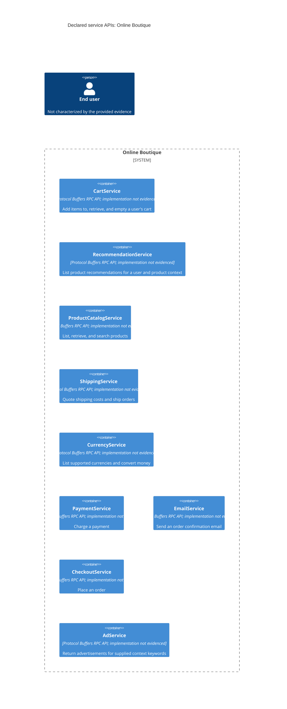

# Recovered Architecture

## Agent

GitHub Copilot using Copilot SDK in VS Code; model not known.

## Files read

- `AGENTS.md`
- `prompts/1-recover-architecture.md`
- `system/online-boutique/protos/demo.proto`

## Containers table

The evidence declares service APIs. It does not establish whether each API is deployed as a separate container, or identify its implementation language or technology. The entries below therefore represent the declared logical services, not verified deployment units.

| Name | Technology/language | Responsibility | Evidence |
|---|---|---|---|
| CartService | Protocol Buffers RPC API; implementation not evidenced | Add items to, retrieve, and empty a user's cart | `system/online-boutique/protos/demo.proto` (`CartService`: `AddItem`, `GetCart`, `EmptyCart`) |
| RecommendationService | Protocol Buffers RPC API; implementation not evidenced | List product recommendations for a user and product context | `system/online-boutique/protos/demo.proto` (`RecommendationService`: `ListRecommendations`) |
| ProductCatalogService | Protocol Buffers RPC API; implementation not evidenced | List, retrieve, and search products | `system/online-boutique/protos/demo.proto` (`ProductCatalogService`: `ListProducts`, `GetProduct`, `SearchProducts`) |
| ShippingService | Protocol Buffers RPC API; implementation not evidenced | Quote shipping costs and ship orders | `system/online-boutique/protos/demo.proto` (`ShippingService`: `GetQuote`, `ShipOrder`) |
| CurrencyService | Protocol Buffers RPC API; implementation not evidenced | List supported currencies and convert money | `system/online-boutique/protos/demo.proto` (`CurrencyService`: `GetSupportedCurrencies`, `Convert`) |
| PaymentService | Protocol Buffers RPC API; implementation not evidenced | Charge a payment using the supplied amount and credit card information | `system/online-boutique/protos/demo.proto` (`PaymentService`: `Charge`) |
| EmailService | Protocol Buffers RPC API; implementation not evidenced | Send an order confirmation email | `system/online-boutique/protos/demo.proto` (`EmailService`: `SendOrderConfirmation`) |
| CheckoutService | Protocol Buffers RPC API; implementation not evidenced | Place an order | `system/online-boutique/protos/demo.proto` (`CheckoutService`: `PlaceOrder`) |
| AdService | Protocol Buffers RPC API; implementation not evidenced | Return advertisements for supplied context keywords | `system/online-boutique/protos/demo.proto` (`AdService`: `GetAds`) |

## Dependencies table

No runtime caller-to-callee dependencies are evidenced. The file declares RPC service methods and message types, but does not identify which service calls another or what transport is used at runtime.

| Caller → callee | Protocol | Evidence |
|---|---|---|
| No dependencies evidenced | Not evidenced | `system/online-boutique/protos/demo.proto` declares service APIs but no caller relationships |

## Mermaid diagram

## Gaps

- The file defines nine RPC service APIs, but whether each corresponds to a deployed container is not evidenced. A deployment manifest such as `system/online-boutique/kubernetes-manifests/` would help establish deployed units.
- Implementation languages and technologies are not evidenced. The service implementation source files would settle this.
- Runtime service-to-service callers and dependencies are not evidenced. Service implementation source or deployment configuration showing the relevant caller settings would settle this.
- The RPC transport/protocol in use at runtime is not evidenced by these declarations alone. Service implementation or client/server configuration would settle this.
- Data stores and their ownership are not evidenced. Data-store implementation or deployment configuration would settle this.
- The end user's identity and interaction with the services are not evidenced. A frontend interface or user-flow description would help establish this.
