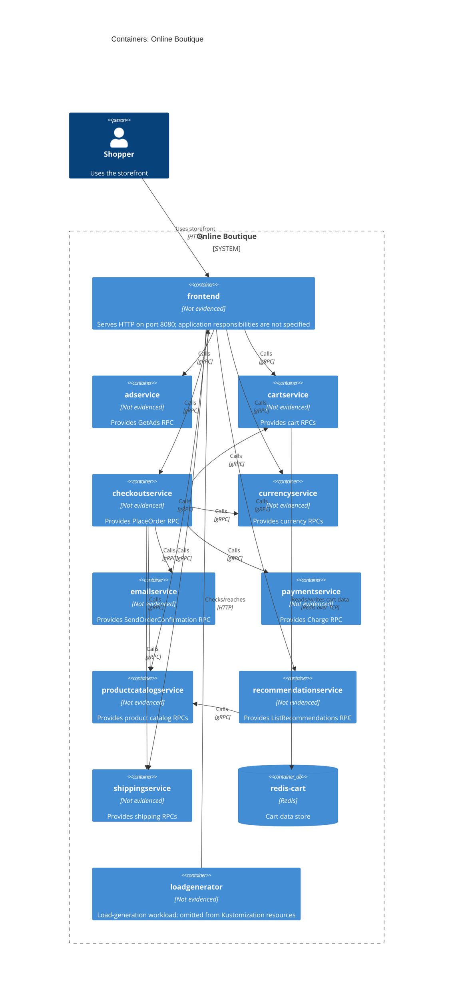

# Online Boutique: Recovered C4 Container Architecture

## Agent

GitHub Copilot SDK in VS Code; model: not exposed in this session.

## Files read

- `prompts/1-recover-architecture.md`
- `system/online-boutique/protos/demo.proto`
- `system/online-boutique/kubernetes-manifests/README.md`
- `system/online-boutique/kubernetes-manifests/adservice.yaml`
- `system/online-boutique/kubernetes-manifests/cartservice.yaml`
- `system/online-boutique/kubernetes-manifests/checkoutservice.yaml`
- `system/online-boutique/kubernetes-manifests/currencyservice.yaml`
- `system/online-boutique/kubernetes-manifests/emailservice.yaml`
- `system/online-boutique/kubernetes-manifests/frontend.yaml`
- `system/online-boutique/kubernetes-manifests/kustomization.yaml`
- `system/online-boutique/kubernetes-manifests/loadgenerator.yaml`
- `system/online-boutique/kubernetes-manifests/paymentservice.yaml`
- `system/online-boutique/kubernetes-manifests/productcatalogservice.yaml`
- `system/online-boutique/kubernetes-manifests/recommendationservice.yaml`
- `system/online-boutique/kubernetes-manifests/shippingservice.yaml`

## Containers table

| Name | Technology/language | Responsibility | Evidence |
|---|---|---|---|
| frontend | Not evidenced | Serves HTTP on port 8080 and is exposed through a LoadBalancer service on port 80; its application responsibilities are not specified. | `system/online-boutique/kubernetes-manifests/frontend.yaml` (`containerPort: 8080`, `frontend-external`) |
| adservice | Not evidenced | Provides the `GetAds` RPC. | `system/online-boutique/protos/demo.proto` (`AdService`); `system/online-boutique/kubernetes-manifests/adservice.yaml` |
| cartservice | Not evidenced | Provides `AddItem`, `GetCart`, and `EmptyCart` RPCs; configured with Redis. | `system/online-boutique/protos/demo.proto` (`CartService`); `system/online-boutique/kubernetes-manifests/cartservice.yaml` (`REDIS_ADDR`) |
| checkoutservice | Not evidenced | Provides the `PlaceOrder` RPC. | `system/online-boutique/protos/demo.proto` (`CheckoutService`); `system/online-boutique/kubernetes-manifests/checkoutservice.yaml` |
| currencyservice | Not evidenced | Provides `GetSupportedCurrencies` and `Convert` RPCs. | `system/online-boutique/protos/demo.proto` (`CurrencyService`); `system/online-boutique/kubernetes-manifests/currencyservice.yaml` |
| emailservice | Not evidenced | Provides the `SendOrderConfirmation` RPC. | `system/online-boutique/protos/demo.proto` (`EmailService`); `system/online-boutique/kubernetes-manifests/emailservice.yaml` |
| paymentservice | Not evidenced | Provides the `Charge` RPC. | `system/online-boutique/protos/demo.proto` (`PaymentService`); `system/online-boutique/kubernetes-manifests/paymentservice.yaml` |
| productcatalogservice | Not evidenced | Provides `ListProducts`, `GetProduct`, and `SearchProducts` RPCs. | `system/online-boutique/protos/demo.proto` (`ProductCatalogService`); `system/online-boutique/kubernetes-manifests/productcatalogservice.yaml` |
| recommendationservice | Not evidenced | Provides the `ListRecommendations` RPC. | `system/online-boutique/protos/demo.proto` (`RecommendationService`); `system/online-boutique/kubernetes-manifests/recommendationservice.yaml` |
| shippingservice | Not evidenced | Provides `GetQuote` and `ShipOrder` RPCs. | `system/online-boutique/protos/demo.proto` (`ShippingService`); `system/online-boutique/kubernetes-manifests/shippingservice.yaml` |
| redis-cart | Redis (`redis:alpine` image) | Cart data store, addressed by `cartservice` at `redis-cart:6379`. | `system/online-boutique/kubernetes-manifests/cartservice.yaml` (`redis-cart` Deployment and Service; `REDIS_ADDR`) |
| loadgenerator | Not evidenced | Runs a load-generation workload that checks/reaches the frontend over HTTP. The manifest exists, but this workload is commented out of the listed Kustomization resources. | `system/online-boutique/kubernetes-manifests/loadgenerator.yaml` (`frontend-check`, `FRONTEND_ADDR`); `system/online-boutique/kubernetes-manifests/kustomization.yaml` |

## Dependencies table

| Caller → callee | Protocol | Evidence |
|---|---|---|
| Shopper → frontend | HTTP | `system/online-boutique/kubernetes-manifests/frontend.yaml` (`frontend-external` LoadBalancer Service, port `http:80`) |
| frontend → productcatalogservice | gRPC | `system/online-boutique/kubernetes-manifests/frontend.yaml` (`PRODUCT_CATALOG_SERVICE_ADDR`); `system/online-boutique/protos/demo.proto` (`ProductCatalogService`) |
| frontend → currencyservice | gRPC | `system/online-boutique/kubernetes-manifests/frontend.yaml` (`CURRENCY_SERVICE_ADDR`); `system/online-boutique/protos/demo.proto` (`CurrencyService`) |
| frontend → cartservice | gRPC | `system/online-boutique/kubernetes-manifests/frontend.yaml` (`CART_SERVICE_ADDR`); `system/online-boutique/protos/demo.proto` (`CartService`) |
| frontend → recommendationservice | gRPC | `system/online-boutique/kubernetes-manifests/frontend.yaml` (`RECOMMENDATION_SERVICE_ADDR`); `system/online-boutique/protos/demo.proto` (`RecommendationService`) |
| frontend → shippingservice | gRPC | `system/online-boutique/kubernetes-manifests/frontend.yaml` (`SHIPPING_SERVICE_ADDR`); `system/online-boutique/protos/demo.proto` (`ShippingService`) |
| frontend → checkoutservice | gRPC | `system/online-boutique/kubernetes-manifests/frontend.yaml` (`CHECKOUT_SERVICE_ADDR`); `system/online-boutique/protos/demo.proto` (`CheckoutService`) |
| frontend → adservice | gRPC | `system/online-boutique/kubernetes-manifests/frontend.yaml` (`AD_SERVICE_ADDR`); `system/online-boutique/protos/demo.proto` (`AdService`) |
| cartservice → redis-cart | Redis over TCP | `system/online-boutique/kubernetes-manifests/cartservice.yaml` (`REDIS_ADDR`, Redis Service port `tcp-redis:6379`) |
| checkoutservice → productcatalogservice | gRPC | `system/online-boutique/kubernetes-manifests/checkoutservice.yaml` (`PRODUCT_CATALOG_SERVICE_ADDR`); `system/online-boutique/protos/demo.proto` (`ProductCatalogService`) |
| checkoutservice → shippingservice | gRPC | `system/online-boutique/kubernetes-manifests/checkoutservice.yaml` (`SHIPPING_SERVICE_ADDR`); `system/online-boutique/protos/demo.proto` (`ShippingService`) |
| checkoutservice → paymentservice | gRPC | `system/online-boutique/kubernetes-manifests/checkoutservice.yaml` (`PAYMENT_SERVICE_ADDR`); `system/online-boutique/protos/demo.proto` (`PaymentService`) |
| checkoutservice → emailservice | gRPC | `system/online-boutique/kubernetes-manifests/checkoutservice.yaml` (`EMAIL_SERVICE_ADDR`); `system/online-boutique/protos/demo.proto` (`EmailService`) |
| checkoutservice → currencyservice | gRPC | `system/online-boutique/kubernetes-manifests/checkoutservice.yaml` (`CURRENCY_SERVICE_ADDR`); `system/online-boutique/protos/demo.proto` (`CurrencyService`) |
| checkoutservice → cartservice | gRPC | `system/online-boutique/kubernetes-manifests/checkoutservice.yaml` (`CART_SERVICE_ADDR`); `system/online-boutique/protos/demo.proto` (`CartService`) |
| recommendationservice → productcatalogservice | gRPC | `system/online-boutique/kubernetes-manifests/recommendationservice.yaml` (`PRODUCT_CATALOG_SERVICE_ADDR`); `system/online-boutique/protos/demo.proto` (`ProductCatalogService`) |
| loadgenerator → frontend | HTTP | `system/online-boutique/kubernetes-manifests/loadgenerator.yaml` (`wget http://${FRONTEND_ADDR}`, `FRONTEND_ADDR=frontend:80`) |

## Mermaid diagram

## Gaps

- The implementation languages for the application services are **Not evidenced in the provided files**. The deployment image names do not establish implementation languages. Their source/build files would settle this.
- `frontend.yaml` sets `SHOPPING_ASSISTANT_SERVICE_ADDR=shoppingassistantservice:80`, but the assistant enablement setting is commented out, and no assistant manifest or RPC contract is in the provided evidence. Whether this is an active runtime dependency is **Not evidenced in the provided files**. The frontend code and the assistant's deployment manifest would settle this.
- `loadgenerator.yaml` defines a Deployment and a request to `frontend`, but `kustomization.yaml` comments it out and says the loadgenerator module is used during development. Whether it runs in the target deployment is **Not evidenced in the provided files**. The relevant deployment configuration would settle this.
- The manifests expose the frontend with a LoadBalancer Service on port 80, but these files do not evidence an external TLS termination point or protocol. The external ingress/load-balancer configuration would settle whether users access it over HTTPS.
- The evidence defines internal PaymentService and EmailService RPCs but does not identify any downstream payment processor or email transport. Those external dependencies are **Not evidenced in the provided files**.
